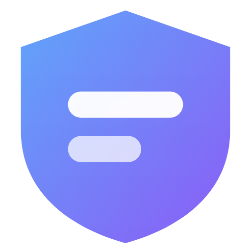

# 🛡️ TabPaladin

<div align="center">



**Your tabs deserve a guardian.**

[](https://github.com/AlexBelguim/TabPaladin)
[](https://github.com/AlexBelguim/TabPaladin)
[](LICENSE)

</div>

---

## ✨ What is TabPaladin?

TabPaladin is a powerful browser extension that helps you **tame tab chaos** and **organize your digital life**. Save your browsing sessions as workflows, sort your bookmarks by your own keywords, and never lose track of your research again.

> *"100 tabs open? No problem."* — Every TabPaladin user

---

## 🚀 Features

### 📁 **Workflow Management**
- **Save Sessions** — Capture all open tabs as a named workflow with one click
- **Restore Anytime** — Reopen entire workflows in a new window
- **Import/Export** — Backup your workflows to JSON files

### 🗂️ **Keyword Organization**
- **Smart Grouping** — open tabs and bookmarks grouped by built-in categories and your own keywords
- **Folder Suggestions** — Analyze & Sort and Split propose where each bookmark goes; nothing moves until you apply it
- **Your keywords, your folders** — export and import your keywords and any folder as JSON

There is no built-in AI and no API key to enter: nothing is sent to an AI service.
An AI chat you choose can read your bookmarks and notes and suggest changes
instead — through the sync server's temporary share link, or over MCP from
Claude Code or Claude Desktop — and nothing is applied until you approve it.
See [Use TabPaladin with AI chats](#-use-tabpaladin-with-ai-chats).

### 🗄️ **Server-owned bookmarks** (needs the sync server)
- **One tree, any browser** — your bookmarks live in the sync server's database, not in any browser's own bookmark store, so Chrome, Firefox, Opera and the phone all see the identical tree
- **Git-style sync** — edit locally (works offline), then **Push**; **Pull** fetches the server's tree. A push is refused if another device pushed since your last pull, so nothing is silently overwritten
- **Import from any browser** — one click copies a browser's existing bookmarks into the tree; the browser's own bookmarks are never touched again

### 📥 **Importers** (Optional, needs the sync server)
- **Reddit saved posts** — Reddit only ever shows your most recent 1000 saves. TabPaladin sweeps the list on a schedule and keeps everything it has seen, so your archive outgrows the cap
- **X & Instagram** — neither can be fetched (no free API on one, no personal saved list on the other), so share a post to TabPaladin from your phone and it lands in the same archive
- **A read-only folder in your tree** — the archive appears as a normal-looking folder on every device; deleting an item tombstones it on the server, and dragging one out files a copy into your own tree
- **One-way** — deleting an import in TabPaladin never un-saves anything on Reddit

See [server/README.md](server/README.md#importers) for setup.

### 🎬 **Bonus: Video Scroll Seek**
- Scroll wheel to fast-forward/rewind fullscreen videos
- Works on YouTube, Netflix, and more!

---

## 📦 Installation

Two clients, one tree. The **extension** is the full desktop client — it's the
only one that can capture open tabs into workflows and auto-sync them on tab
close. The **web app** (served by the sync server) is the client for phones
and for any machine without the extension.

### Extension (desktop)

- **Chrome**: `chrome://extensions` → Developer mode → **Load unpacked** → the repository folder
- **Firefox**: build the package first (below), then `about:debugging#/runtime/this-firefox` → **Load Temporary Add-on** → `dist/firefox.zip`

#### Updating a sideloaded extension

Update in place, never by removing and adding it again: Chrome derives the
extension's id from its folder, and a new id starts with empty storage.

- **Chrome / Edge / Opera**: `git pull` in the same folder, then **Reload** on the extensions page.
- **Firefox**: build the package again and **Reload** it on `about:debugging` (the add-on id, `tabpaladin@extension`, stays the same).

Before you reload, **save or close any note you are editing and Push**. From
1.0.1 on, the extension keeps the text of a note you are typing (half a second
after your last key) and writes other edits within a moment, so a reload costs
at most the last keystrokes, and open workflow windows stay tracked across the
update. The update *to* 1.0.1 still runs the old code and has none of that. If
in doubt, **Settings → Backup → Download a backup** first: one file with
everything this browser holds, minus your sign-in session.

TabPaladin does not run in private (incognito) windows.

TabPaladin is moving into the sync server's web app; the extension will become
a small helper for the tab features. Push your edits before each update.

#### Packaging for the stores

```bash
node tools/package.mjs
```

Writes `dist/chrome.zip` (Chrome Web Store, Opera, Edge) and `dist/firefox.zip`
(AMO), each with its manifest at the zip root and only `src/` and the icons.
No dependencies beyond Node. The Firefox manifest in `firefox/` uses `../`
paths so it can live beside the Chrome one; the script rewrites them, so load
Firefox from the zip, not from `firefox/`.

### Web app (phone + anywhere else)

Run the sync server (see [server/README.md](server/README.md)), open
`https://<your-server>` and sign in. On a phone, install it as a PWA for
share-sheet capture. To bring in a browser's existing bookmarks without the
extension, export them from that browser's bookmark manager and upload the
HTML file in **Settings → Import bookmarks** — works with any browser.

---

## 🎮 How to Use

1. **Click the TabPaladin icon** in your toolbar to open the app
2. **Create Workflow** — Save all your current tabs (extension)
3. **View Workflows** — Restore, open, or delete saved sessions (both clients)
4. **Organize Bookmarks** — Sort folders by keyword, reviewing every move first
5. **Push / Pull** — git-style sync; edit offline, push when ready

---

## 🤖 Use TabPaladin with AI chats

An AI chat can read your bookmarks and notes and **suggest** changes: new
folders, new bookmarks, moves, renames, deletions, notes. **Nothing changes
until you approve it** in the web app: bookmark suggestions wait on
**Home › Suggested changes**, note suggestions in **Notes**. Each one shows
what it would do, line by line, where it came from and the chat's reason; a
deletion is flagged in red and asked about again. One whose bookmarks changed
since it was made is marked out of date and can only be rejected — it is
never half-applied. Approving on a phone with unpushed edits asks you to push
first, as for any change made on the server.

Everything goes through your own sync server. It needs the server (see
[server/README.md](server/README.md)); the web app is where you approve.

| Chat | How it connects | What works |
|---|---|---|
| Any chat that can browse (ChatGPT, Claude.ai, …) | a 1-hour share link | Reads everything. Suggests changes if it can send a POST request; most can't, and then it gives you a review link to tap |
| Claude Code | MCP, with a token | Everything: search, browse, read, suggest, check what it suggested |
| Claude Desktop | MCP through a small bridge in this repository, set up in its config file | Everything, on a computer with Node 18+ and this repository |
| claude.ai (web, mobile) and Claude Desktop's *Connectors* | — | **Not as a connector yet**: those sign in with OAuth, which TabPaladin does not have. Use the share link there |

### Any chat that can browse: the share link

1. In the web app: **Settings → AI chats → 🔗 1-hour link** (or **Notes →
   🔗 Share notes & bookmarks with an AI chat**). The link is copied.
2. Paste it into the chat with what you want, for example: *"This is my
   TabPaladin: <link>. Sort the bookmarks in my Inbox folder into topic
   folders."*
3. The chat reads the page: every folder with its id and path, the first 300
   bookmarks, every note, and links to read the rest page by page, folder by
   folder, or by search. To change something it sends a proposal — or, if it
   cannot send POST requests (ChatGPT's browsing and Claude.ai's web fetch
   only read), it gives you a review link (`https://<your server>/#changes=…`
   for bookmarks, `#note=…` for a note). Tap it: the app asks before filing
   it as a suggestion.
4. Approve or reject on Home (bookmarks) or in Notes (notes).

Anyone who has the link can read your notes and bookmarks until it expires
(1 hour), so give it only to the chat you mean. Some chats fetch only links
that appear on a page they already read; the page's paging and folder links
do, a search address the chat makes up may not.

### Claude Code

1. **Settings → AI chats → + New MCP token**, with a name such as
   *Laptop · Claude Code*. The token is shown **once**, with the command below
   filled in; copy it.
2. In a terminal:

   ```bash
   claude mcp add --transport http --scope user tabpaladin https://<your server>/mcp \
     --header "Authorization: Bearer tpm_…"
   ```

3. In Claude Code, `/mcp` shows *tabpaladin* connected. Ask, for example:
   *"Find my bookmarks about Rust and suggest a folder for them."*

`claude mcp add` keeps the token in `~/.claude.json`. To keep it out of
files, put it in an environment variable and use a `.mcp.json` (never commit
a token):

```json
{
  "mcpServers": {
    "tabpaladin": {
      "type": "http",
      "url": "https://<your server>/mcp",
      "headers": { "Authorization": "Bearer ${TABPALADIN_MCP_TOKEN}" }
    }
  }
}
```

### Claude Desktop

Desktop's *Add custom connector* signs in with OAuth, which TabPaladin does
not have yet. Its config file starts local MCP servers instead, so a small
bridge in this repository, `tools/mcp_bridge.mjs` (Node 18+, no
dependencies), passes the token on:

1. Make a token as for Claude Code.
2. **Claude Desktop → Settings → Developer → Edit Config**, and add (Windows
   path shown; on a Mac, `/Users/<you>/TabPaladin/tools/mcp_bridge.mjs`):

   ```json
   {
     "mcpServers": {
       "tabpaladin": {
         "command": "node",
         "args": ["C:\\path\\to\\TabPaladin\\tools\\mcp_bridge.mjs", "https://<your server>/mcp"],
         "env": { "TABPALADIN_MCP_TOKEN": "tpm_…" }
       }
     }
   }
   ```

3. Quit Claude Desktop completely (on Windows from the tray icon) and start
   it again. The TabPaladin tools appear in the chat's tools menu.

The token sits in that file as plain text: revoke it in Settings if the
computer is lost.

### claude.ai (web and mobile)

Not as a connector yet. claude.ai's custom connectors (and Desktop's, and
mobile's) connect from Anthropic's servers and sign in with OAuth 2.1;
TabPaladin hands out plain tokens. What works there today is the share link.
(If your organization's *Add custom connector* dialog shows a **Request
headers** section — a beta for some organizations — a connector with
*No sign-in*, URL `https://<your server>/mcp` and the header `authorization`
set to `Bearer tpm_…` should work, with the server reachable from the
internet. That path is untested.) What adding OAuth would take is written
down in [server/README.md](server/README.md#mcp-ai-chats-with-a-token).

### Tokens

**Settings → AI chats** lists your tokens with when each was made and last
used, and revokes them. A token can read and suggest, nothing else: it opens
no other part of the server. Changing your password (or an admin resetting
it) revokes all of yours, and so does deleting the account. The server keeps
only a hash of each.

---

## 🏗️ Project Structure

```
TabPaladin/
├── server/                 # Node + SQLite sync server — owns the bookmark tree
├── pwa/                    # The web app (desktop + phone), served by the server
├── tools/                  # Headless tests, recovery scripts, package.mjs, the MCP bridge for Claude Desktop
├── manifest.json           # Chrome extension manifest (v3)
├── firefox/                # Firefox add-on manifest (v2; packaged by tools/package.mjs)
├── src/                    # Extension source (tab capture, workflows, organizer UI)
└── assets/                 # Shared icons and images
```

---

## 🤝 Contributing

Contributions are welcome! Feel free to:
- 🐛 Report bugs
- 💡 Suggest features
- 🔧 Submit pull requests

---

## 📜 License

Copyright (C) 2026 AlexBelguim

TabPaladin is free software: you can redistribute it and/or modify it under the terms of the
[GNU Affero General Public License v3.0](LICENSE). If you run a modified version as a service
for other people, you must make your modified source available to them.

See [PRIVACY.md](PRIVACY.md) for what data TabPaladin handles and where it goes.

---

<div align="center">

**Built with ☕ and too many open tabs**

[⬆ Back to Top](#-tabpaladin)

</div>
